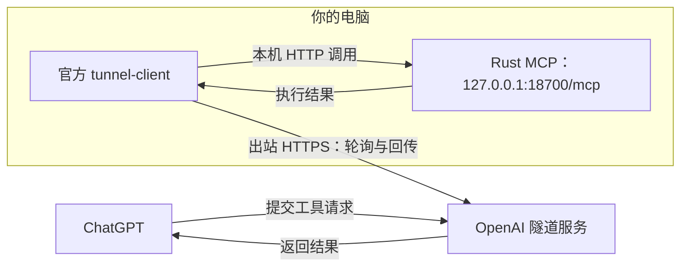

# ShellMCP Tunnel

原生 Rust 本地 MCP 服务，通过官方 OpenAI `tunnel-client` 接入 ChatGPT。Linux、macOS、Windows 共用执行核心，安装器下载并管理官方隧道客户端，安装和运行无需 Python。

当前为早期版本：Linux x86_64 与 Windows x86_64 已实测，macOS 服务安装和 ARM64 完整安装尚未实机验收，ChatGPT 外部工具调用也仍待验收。具体见 [验收记录](docs/acceptance.md)。使用前阅读 [安全边界](SECURITY.md)。

## 连接机制

本项目使用 [OpenAI Secure MCP Tunnel 官方机制](https://developers.openai.com/api/docs/guides/secure-mcp-tunnels)：`tunnel-client` 主动通过出站 HTTPS 轮询 OpenAI，取回工具请求、转交本机 Rust MCP，再回传结果。电脑需要能访问 `api.openai.com:443`；本地 MCP 保持回环监听，无需开放公网入站端口。



本项目的安装器负责部署图中的两个本机组件，并配置它们之间的 HTTP 连接。OpenAI 托管隧道由用户在 Platform 创建和授权。

## 准备 Tunnel ID 和 key

1. 在 [Platform 隧道设置](https://platform.openai.com/settings/organization/tunnels) 创建或选择隧道，取得 `tunnel_id`。创建/管理需要组织级的 **Tunnels Read + Manage** 权限。
2. 将隧道关联到目标 Platform 组织和 ChatGPT 工作区。运行客户端、在 ChatGPT 中选择隧道需要 **Tunnels Read + Use**；ChatGPT 工作区还需允许使用自定义 MCP。
3. 准备有相应隧道使用权限的 API key，安装时由 Agent 保存为本机私有文件。key 由 tunnel-client 使用，不作为本地 MCP 的 Bearer 凭据。

权限与关联规则以 [官方接入说明](https://developers.openai.com/api/docs/guides/secure-mcp-tunnels#permissions-and-access) 为准；安装器不会创建隧道或修改工作区权限。

## 安装

只需填写下面的 Tunnel ID 和 API key，把整段提示词交给能操作目标电脑终端的 Agent：

```text
请在这台电脑上安装 ShellMCP Tunnel，让 ChatGPT 通过 OpenAI 隧道调用这台电脑的工具。

安装说明：https://github.com/sunnoy/shellmcp-tunnel/blob/main/docs/usage.md#安装
Tunnel ID：<填写你的 Tunnel ID>
API key：<填写你的 API key>

请识别当前系统，按安装说明下载并执行对应的 Release 安装脚本，传入 Tunnel ID 和 key 文件路径。Rust agent 从 sunnoy/shellmcp-tunnel 的 GitHub Release 下载预编译二进制，tunnel-client 由安装器从 OpenAI 官方 GitHub Release 下载并校验。不要 clone 仓库或从源码构建，不需要安装 Git、Rust 或 Python。使用默认配置，设置后台运行和登录自启动；Windows 下应无窗口运行。

请将 API key 保存到仅当前用户可访问的私有文件，通过文件传给安装器，不要回显密钥，也不要把它写入源码、命令参数或日志。

完成后检查两个后台服务、本机 MCP 就绪状态和 OpenAI 隧道轮询是否成功，报告实际结果、安装位置和检查/卸载命令，并告诉我如何在 ChatGPT 中连接这个隧道。
```

## 使用

### 接入 ChatGPT

安装完成后，保持两个后台服务运行：

1. 运行 `shellmcp-agent local doctor`，确认本地 MCP 与隧道均就绪。
2. 在 [ChatGPT Plugins](https://chatgpt.com/plugins) 添加自定义 MCP，连接方式选 **Tunnel**，选择或填写安装时的 Tunnel ID。本项目的本地 MCP 无应用层认证，认证选 **No Auth**。
3. 在对话中启用该连接，要求调用 `get_environment`，核对返回的主机、系统和版本。

看不到隧道时，先核对上面的工作区关联和权限。[官方 ChatGPT 接入步骤](https://developers.openai.com/api/docs/guides/secure-mcp-tunnels#connect-from-chatgpt)

### 日常管理

```sh
shellmcp-agent local doctor                # 同时检查实际运行的两个组件
shellmcp-agent local policy --mode read_only  # full | read_only | disabled
shellmcp-agent local audit --tail 20
shellmcp-agent local recover               # 仅用于中断的安装事务
shellmcp-agent local uninstall             # 移除服务，保留本地数据和发行文件
shellmcp-agent local uninstall --purge     # 额外删除本安装目录；拒绝仍有后台作业
```

独立测试 MCP，无需隧道或任何 key：

```sh
shellmcp-agent local init
shellmcp-agent local run
```

15 个工具来自 [统一工具目录](protocol/tools.json)：文件列表、读取、搜索、写入、编辑、移动、建目录，环境信息，以及 shell 和后台作业管理。Unix 用 bash/sh，Windows 用 PowerShell。`timeout_s` 最大同步等待 30 秒，超时返回 `job_id`，命令继续运行；用 `job_output` 查询。非零退出码标为工具错误。当前没有 PTY 或交互 stdin。

Host/Origin 校验、仅回环监听、无 CORS。副作用按实例、会话、JSON-RPC 请求 ID 去重；相同 ID 修改参数会拒绝。进程崩溃后不自动重放执行状态不明确的请求。重连建立新会话属于新请求，调用者须先查询已有 job。这是当前 OS 用户权限下的 shell，不是容器沙箱。

## 开发

```sh
git clone https://github.com/sunnoy/shellmcp-tunnel.git
cd shellmcp-tunnel
cargo build --release --locked --bin shellmcp-agent --bin shellmcp-host
cargo test --locked
cargo clippy --locked --all-targets -- -D warnings
```

开发使用支持 Rust 2024 edition 的稳定工具链和平台原生 C/C++ 编译工具，构建产物在 `target/release/`。发布版本由 GitHub Actions 构建六个平台的原生二进制，生成带 SHA-256 的安装脚本并上传到 [Releases](https://github.com/sunnoy/shellmcp-tunnel/releases)。当前没有定时自动更新；更新时重新下载 Release 安装脚本并执行，安装器替换两个服务并验证，失败则恢复之前的服务定义和发行目录。官方 tunnel-client 版本固定为 v0.0.16，不跟踪 latest。

打包、服务管理和平台限制见 [操作文档](docs/usage.md)，验证范围见 [验收记录](docs/acceptance.md)。

## 许可证

本项目使用 [Apache-2.0](LICENSE)。官方 tunnel-client 是独立项目，安装器保留其发行包中的许可证文件；本项目不是 OpenAI 官方产品。
